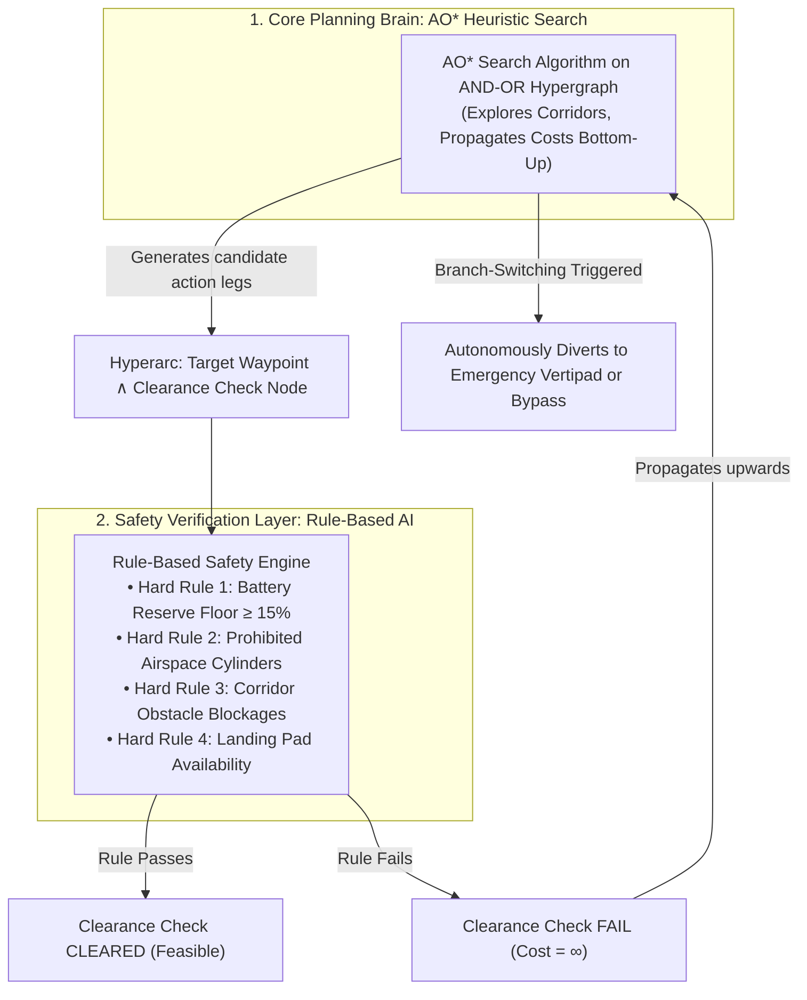

# AERON: FOAI Project Explanation & Technical Guide
> **Subject**: Foundations of Artificial Intelligence (FOAI) / Computational Intelligence  
> **Topic**: Autonomous Aerial Vehicle Flight Planner (Roadster Aero EVTOL Concept)  
> **PDF Version**: [`AERON_FOAI_Project_Explanation.pdf`](./AERON_FOAI_Project_Explanation.pdf)  
> **Full Technical Report**: [`PROJECT_REPORT.md`](./PROJECT_REPORT.md)  
> **Presentation Screenshots**: [`presentation_images/`](./presentation_images/)

---

## 💡 The Core Question: Did We Use AO* or Rule-Based AI?

### **Direct Answer**:
> **"Our project uses a Hybrid AI Architecture combining BOTH AO\* and Rule-Based AI."**

- **AO\* Heuristic Search Algorithm** is the **Primary Graph Planning Engine**. It operates on an **AND-OR Graph** to evaluate complex composite corridors, propagate costs bottom-up, and dynamically switch branches when conditions change.
- **Rule-Based AI** is the **Deterministic Safety Auditor**. It evaluates strict aerospace laws (15% battery reserve floor, cylinder no-fly zones, obstacle blocks).

### **How They Work Together (The Connection)**:
The Rule-Based AI evaluates every corridor and sets the validity of the **AND conjunct check nodes** in the AO* graph.  
If any safety rule fails (e.g., remaining battery drops below the 15% emergency reserve floor):
1. The rule engine marks the conjunct check node as **`FAIL (Cost = ∞)`**.
2. This failure propagates up the AND-OR graph.
3. **AO\* immediately prunes that corridor and triggers automatic branch switching**, routing the vehicle through a safe bypass or diverting to an emergency landing vertipad!

---

## 1. What Is This Project About? (Simple Explanation)

When driving a car, navigation systems (like Google Maps or traditional A* search) simply find the shortest route between two coordinates. If the car runs low on fuel or hits traffic, the driver can pull over.

In **urban aerial transport (flying cars / EVTOLs)**, vehicles cannot stop mid-air. Standard pathfinding algorithms fail because:
1. Moving between two skyscraper corridors requires reaching the next waypoint **AND** simultaneously checking that the remaining battery will not breach the emergency reserve ($15\%$).
2. Weather shifts (crosswinds and turbulence) increase aerodynamic drag dramatically ($P_{\text{drag}} \propto v^3$).

**AERON introduces “AI That Imagines Before It Acts”**:
- Before take-off, it runs **6 pre-flight counterfactual scenarios** ("What if battery degrades by 25%?", "What if a drone swarm blocks the primary skyway?").
- If a low battery state is detected (e.g. $32\%$), the AI does not crash. It autonomously realizes the destination is unreachable and **diverts to a certified emergency vertipad** (*Industrial Tech Vertipad Alpha*).

---

## 2. Complete Technology Stack

| Layer | Technology Used | Role & Contribution |
|---|---|---|
| **Core Search Algorithm** | AO\* Heuristic Search (Pure Python from Scratch) | Navigates AND-OR graph, propagates bottom-up costs, marks best partial tree, guarantees admissible lower-bound optimality. |
| **Safety Reasoning** | Deterministic Rule-Based Engine | Audits hard rules (&ge;15% reserve, no-fly zones, pad status) and soft costs (turbulence). |
| **Aerodynamics & Physics** | Kinematic Flight & Drag Model | Computes drag ($v^3$), climb power, **28% descent regeneration**, and wind turbulence factor. |
| **Backend Web Service** | Python 3.9+, FastAPI, Pydantic v2, Uvicorn | High-performance asynchronous REST API (`/api/plan`, `/api/replan`, `/api/counterfactuals`). |
| **Frontend & 3D Graphics** | React 18, TypeScript, Three.js, React Three Fiber | Renders real-time 3D Metropolis airspace, procedural skyscrapers, and live flight telemetry HUD. |
| **Verification & Baselines** | Pytest, Baseline A\* & Greedy BFS | 10 passing unit/integration tests; empirical evaluation across 5 seeded benchmark missions. |

---

## 3. AO* Algorithm & AND-OR Hypergraphs (Deep Dive)

### Why Standard A* Search Fails in Urban Airspace
Standard search algorithms (like Dijkstra, A*, or Greedy BFS) assume **serial transitions**: an action transitions the agent from state $u$ to state $v$.

In autonomous flight, moving along a corridor involves **decomposed subgoals and contingent constraints**. To take corridor $A \to B$, reaching waypoint $B$ is only valid if environmental clearance simultaneously succeeds:
$$\text{Action}(W_i \to W_j) \implies W_j \wedge \text{ClearanceCheck}(W_i, W_j)$$

- **OR Nodes (Alternative Choices)**: Waypoints where the vehicle chooses between alternative departure corridors (e.g., choice between North Skyway, Waterfront Low Corridor, or Central Core).
- **AND Nodes (Conjunctive Hyperarcs)**: Selecting a corridor connects to **both** the target waypoint **AND** a safety clearance node. If remaining battery $< 15\%$ or corridor is blocked, that conjunct fails!

### Multi-Objective Admissible Heuristic $h(n)$
A heuristic is **admissible** if it never overestimates true remaining cost. AERON computes straight-line 3D Euclidean distance at maximum velocity ($60\text{ m/s}$) with ideal minimum cruise power ($15\text{ kW}$):
$$t_{\text{ideal}} = \frac{D_{\text{3D}}}{v_{\text{max}}}, \quad E_{\text{ideal}} = \frac{P_{\text{min}} \cdot t_{\text{ideal}}}{3600}, \quad h(n) = w_{\text{time}} \cdot \frac{t_{\text{ideal}}}{10} + w_{\text{energy}} \cdot (4 \cdot E_{\text{ideal}})$$

Because any realistic flight has wind resistance, altitude climbs, and maneuvers, actual time and energy will always be greater than or equal to this estimate ($h(n) \le h^*(n)$), guaranteeing global optimality.

### Bottom-Up Cost Propagation
When expanding candidate leaf nodes, costs propagate upwards:
$$f(n) = \min_{A \in \text{Hyperarcs}(n)} \left[ c(A) + \sum_{m \in \text{Targets}(A)} f(m) \right]$$
If any conjunct target in an AND branch is infeasible ($\infty$), that entire hyperarc becomes $\infty$.

---

## 4. Rule-Based AI: Hard Rules vs. Soft Costs

| Constraint Type | Rule Definition | System Reaction |
|---|---|---|
| **Hard Rule 1: Battery Reserve** | Final landing state must preserve $\ge 15.0\%$ Emergency Reserve Floor. | If SoC $< 15\%$, clearance conjunct fails (`Cost = ∞`). Planner prunes branch. |
| **Hard Rule 2: No-Fly Airspaces** | Flight leg must not intersect 3D cylindrical restricted zones (Civic Sanctuary). | Corridor is immediately eliminated from candidate actions. |
| **Hard Rule 3: Corridor Blockage** | Corridor must be free of airborne obstacles or drone swarms. | Blocked corridor marked infeasible; AO\* selects alternative bypass. |
| **Hard Rule 4: Pad Availability** | Destination vertipad must be certified and open for landing. | If destination pad closes, terminal goal shifts to emergency vertipad. |
| **Soft Preference 1: Weather Drag** | Avoid coastal crosswinds and storm gale turbulence cells. | Adds soft cost multiplier (up to $2.4\times$) to edge weights. |
| **Soft Preference 2: Mission Priority** | User weights for `BALANCED`, `SAFEST`, `LOWEST_ENERGY`, or `SHORTEST_TIME`. | Dynamically scales weights between time, energy (kWh), and risk. |

---

## 5. Empirical Benchmark Results (AO* vs. Baselines)

Tested across 5 seeded, reproducible benchmark scenarios:

| Benchmark Scenario | AO\* Result | Standard A\* Result | Greedy Search Result |
|---|---|---|---|
| **B1: Nominal Urban Transit** | **Solved (1.8 ms)** | Solved (0.9 ms) | Solved (0.8 ms) |
| **B2: High-Speed Skyline** | **Solved (1.7 ms)** | Solved (0.8 ms) | Solved (0.7 ms) |
| **B3: Severe Weather Gale** | **Solved (1.9 ms)** | Solved (1.0 ms) | Solved (0.9 ms) |
| **B4: Dense Constraints** | **Solved (2.4 ms)** | Solved (1.3 ms) | **Failed (Trapped in loop)** |
| **B5: Critical Battery Reserve** | **Solved (Diverts to Pad)** | **Failed (Infeasible)** | **Failed (Infeasible)** |

*Observation*: In B5, standard A\* returns failure because it only searches for paths leading directly to the closed/unreachable destination. AO\* evaluates the conjunctive clearance check, prunes the destination branch, and autonomously identifies the certified emergency vertipad landing branch.

---

## 6. Top 5 Viva / Exam Questions & Answers

### Q1: "Why did you use AO* instead of standard A* for this project?"
> **Answer**: *"Standard A* assumes simple serial transitions where one action leads to one state. But in autonomous aerial flight, taking a corridor requires decomposed subgoals and contingent constraints: reaching the next waypoint **AND** simultaneously clearing environmental safety checks (15% reserve battery, no prohibited airspace, no obstacles). AO\* operates directly on **AND-OR graphs**, allowing conjunctive safety verification and automatic branch switching."*

### Q2: "So where does Rule-Based AI fit in if you are using AO*?"
> **Answer**: *"Our system is a **Hybrid AI architecture**. The Rule-Based AI acts as the deterministic safety auditor that defines the validity of the AND conjunct nodes. If a hard rule (like the 15% battery reserve floor) is violated, the rule engine marks that conjunct as FAIL with cost infinity. This failure immediately propagates up the AO\* graph, causing AO\* to prune that corridor and reroute to an alternative path."*

### Q3: "What is 'Counterfactual AI' and why is it important here?"
> **Answer**: *"Counterfactual AI means 'evaluating alternative what-if futures before acting.' Instead of blindly launching on a single brittle path, AERON runs 6 deterministic simulations pre-flight (e.g., What if battery drops to 34%? What if the destination vertipad closes?). This proves ahead of time whether the vehicle can safely handle adverse events."*

### Q4: "How do you guarantee that your heuristic is admissible?"
> **Answer**: *"An admissible heuristic must never overestimate remaining cost. We compute straight-line Euclidean distance to the destination assuming the vehicle travels at its maximum possible speed (60 m/s) with ideal minimal cruise power (15 kW). In any realistic flight, wind resistance, altitude changes, and turns will only increase time and energy, guaranteeing $h(n) \le h^*(n)$."*

### Q5: "What happens if a disturbance happens while the vehicle is already in the air?"
> **Answer**: *"We implemented an In-Flight Dynamic Replanner. When an obstacle or battery drop is injected mid-flight, the system captures the vehicle's exact current waypoint and remaining battery state, re-runs AO\* from that position, and smoothly splices the traversed path with the newly optimized trajectory without arbitrary teleportation."*

---

### 🏆 30-Second Elevator Pitch for Your Viva / Demo
> *"AERON is an autonomous aerial vehicle flight planner for urban eVTOL transport. We implemented a hybrid AI system combining ground-up AO\* heuristic search on AND-OR graphs with a deterministic rule-based safety layer. Unlike standard A\* which fails during emergency reserve breaches, AERON evaluates simultaneous safety conjuncts, autonomously diverts to certified vertipads when battery is critical, and pre-simulates 6 counterfactual 'what-if' scenarios before vehicle dispatch."*
